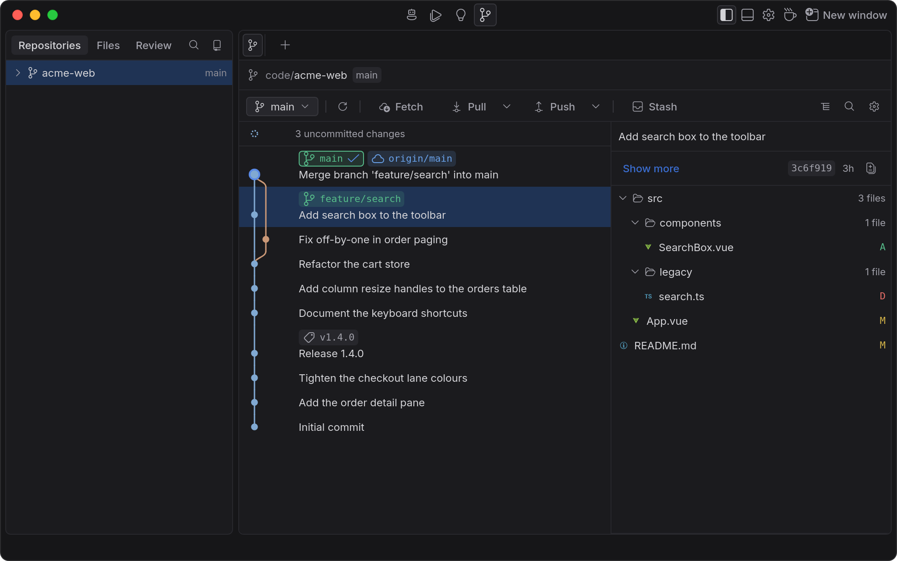
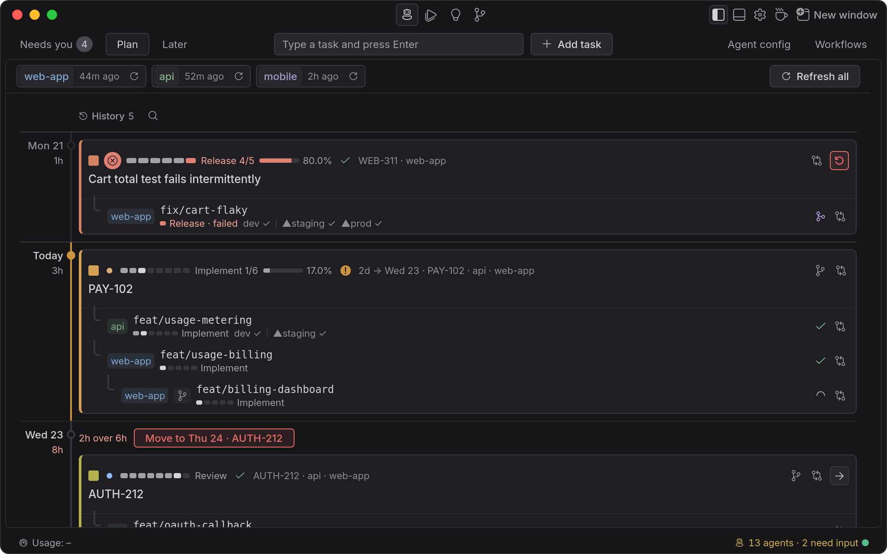
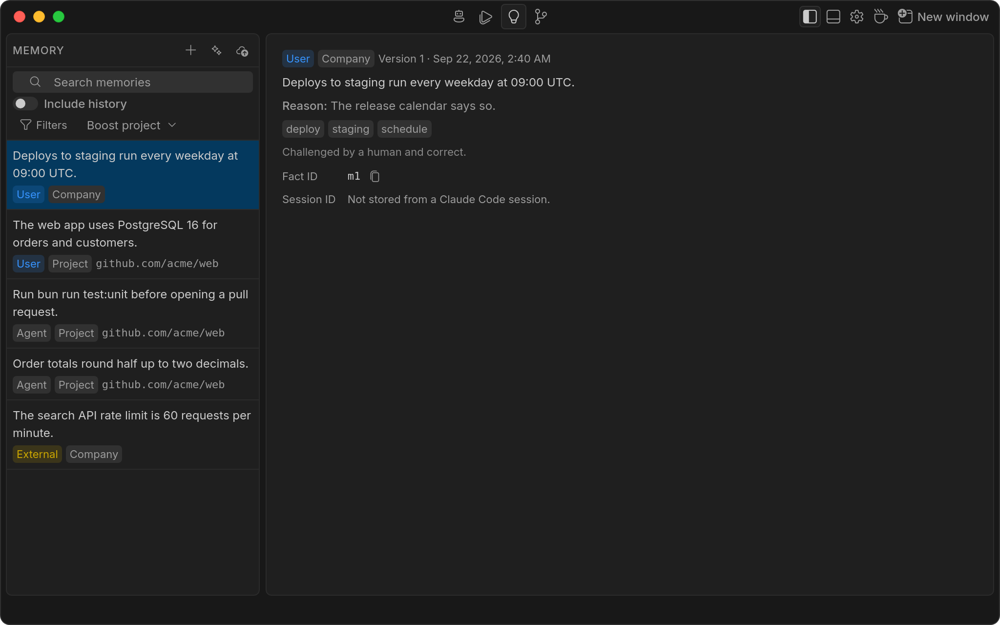
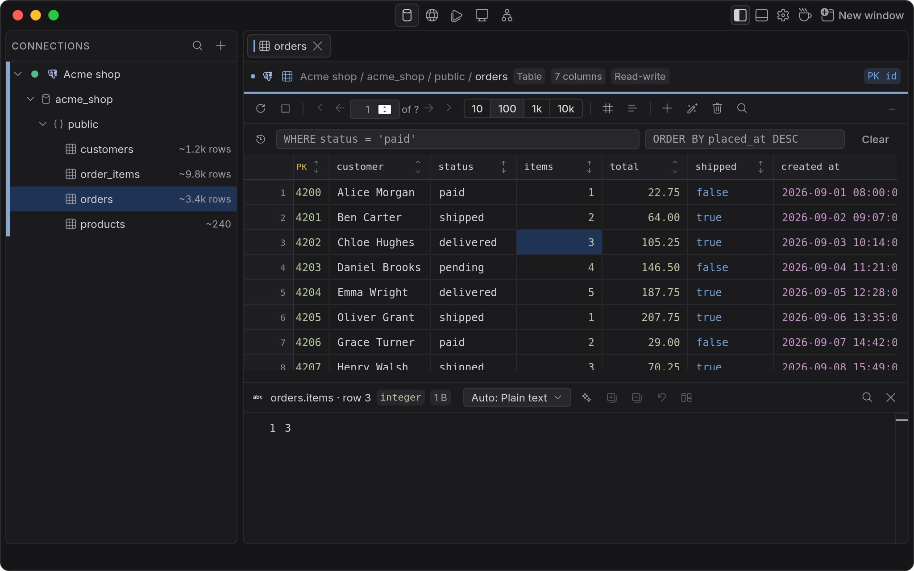
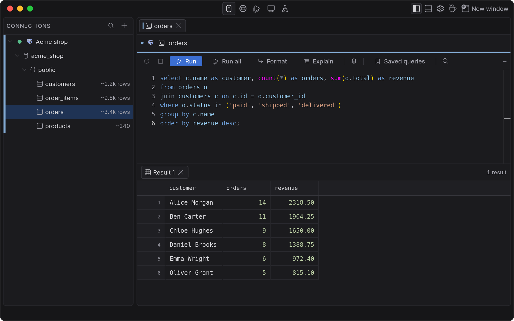
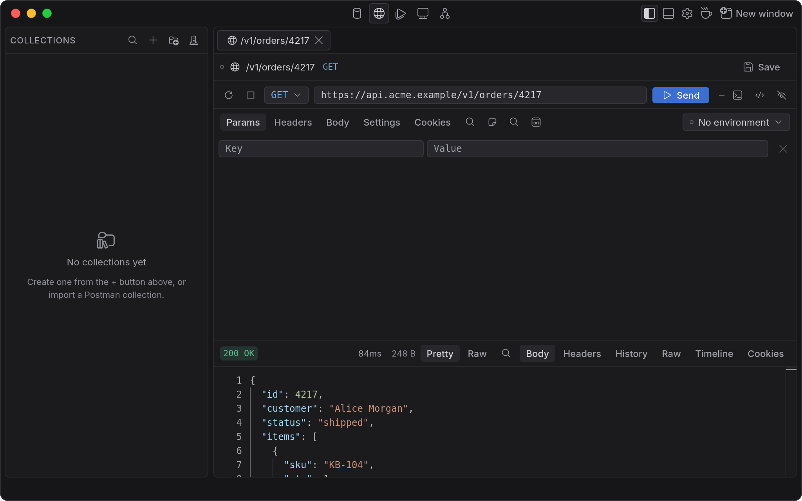

# Kira Space

[](https://github.com/vlad-cirstean/kira-studio/actions/workflows/pr.yml)

Kira Space is a native macOS workbench for developers, built on Wails (Go) and Vue 3. One app holds
a git client and code workspace, coding agents (Claude Code or OpenCode), a memory store, a terminal
and a phone view on your home network. The same window also holds a visual database client for ten
engines (DataGrip/DBeaver class), an HTTP/gRPC API client (Postman/Insomnia class), a Kubernetes
view and a Docker manager. You switch between modules with the mode switcher: **Agents**,
**Automations**, **Memory**, **Git**, **Studio** (databases), **Api**, **Docker** and **Kubernetes**.

Kira Space replaces the former Kira Studio app. Its database, API and Docker modules now live inside
Kira Space. See [Upgrading from Kira Studio](#upgrading-from-kira-studio).

See the presentation page: [Kira Space](https://vlad-cirstean.github.io/kira-studio/).

## Screenshots



The git graph: branches, tags and commit detail.



The agents board: tasks across stages, with runs live.



Memory: every fact shows its origin and scope.



The Studio module's data grid: filter, sort, edit and commit rows.



The SQL console: run a statement or the whole script.



The Api module: HTTP and gRPC requests with a JSON response.

## Status

- **Beta.** Expect bugs and breaking changes between builds.
- **macOS 26+ on Apple Silicon (`arm64`) only, dark mode only.**
- Builds are **ad-hoc signed, not notarized**. Because each new build counts as a different app to
  the Keychain, the first launch after an update may ask to use "confidential information stored
  in…" — choose **Always Allow** once for that build.
- Saved credentials, secret script parameters and agent secrets are encrypted at rest, with the key held in the macOS Keychain.

## Install

Run in Terminal. It installs a fresh copy or replaces an older one, then opens the app:

```sh
curl -fsSL https://raw.githubusercontent.com/vlad-cirstean/kira-studio/main/scripts/install.sh | sh
```

The script downloads the latest release's disk image, moves the app into `/Applications` and opens
it, with no Gatekeeper prompt (unlike a DMG downloaded through a browser). If an old Kira Studio is
installed, the script moves it to the Trash. Once installed, the app checks GitHub for a newer
release and offers to update; nothing installs until you click **Update**.

### Upgrading from Kira Studio

Kira Studio no longer ships as a separate app. Running the install command above installs Kira Space
and moves `Kira Studio.app` to the Trash. The installer does not touch `~/.kira-studio/`. On first
launch Kira Space folds that folder into `~/.kira-space/`: your saved connections, scripts, runs and
Api collections move over, and the whole old folder is kept as a backup under
`~/.kira-space/backups/` until you delete it. Quit Kira Studio first; Kira Space refuses to start
while the old app is still running.

### Building from source

```sh
git clone https://github.com/vlad-cirstean/kira-studio.git
cd kira-studio
bun run package
```

This installs its own dependencies first (the Bun workspace, the Go module and the pinned `wails3`
CLI), so a fresh clone needs nothing else run beforehand. The app lands at
`apps/kira-space/bin/Kira Space.app` and its disk image at `apps/kira-space/bin/Kira Space.dmg`.

A locally built app has not gone through the installer, so its first launch needs a Gatekeeper
workaround — right-click it and choose Open, or run:

```sh
xattr -dr com.apple.quarantine "apps/kira-space/bin/Kira Space.app"
```

See [`docs/PACKAGING.md`](docs/PACKAGING.md) for the bundle layout, releases and the verification
checklist.

## Features

### Code workspace and git

- **Repository import** — a git repository opens as its own workspace with an isolated tab set.
- **Project tree and file viewer** — every tracked or untracked-but-not-ignored file opens read-only
  in Monaco. Diff tabs show worktree-vs-HEAD in Monaco's diff editor.
- **Search** — in-file through Monaco's find widget; repository-wide in Go with streamed results
  and no `ripgrep` subprocess.
- **Inline git blame** — a per-line annotation toggled in Appearance settings. The status bar shows
  the cursor line's author, date and summary regardless.
- **Commit graph** — a virtualized, lane-drawn log over the whole ref set, streamed from the backend
  as binary FlatBuffers chunks, with ref badges, a HEAD indicator and in-graph search.
- **Commit detail and diffs** — file tree, per-file and whole-commit diffs, and a line-mapped
  **Go to file** that works on history not checked out on disk.
- **Refs and history rewriting** — branches and tags, checkout, revert, reset in all three modes,
  cherry-pick, and Continue/Abort/Skip for a merge, rebase or cherry-pick left mid-flight.
- **Pre-flight and undo** — every hazardous operation is classified in Go before it runs
  (uncommitted work, detached `HEAD`, protected branch). A single-slot undo covers the last
  undoable operation per repository.
- **Remote operations** — fetch, push, force-with-lease, a decomposed pull with a strategy picker,
  background auto-fetch and real cancellation. A credential prompt opens in the app window.
- **Stash, worktrees and stacked branches** — the full stash stack with conflict prediction,
  `git worktree` management with an optional prepare script, and restacking.
- **Branch review** — incremental review state kept per file as a content snapshot, so a rebase,
  squash or amend still diffs correctly, plus AI review comments you export as plain text.
- **Change request links** — GitHub pull requests resolved per commit and shown inline. Auth is
  delegated to the `gh` CLI already on your machine; Kira Space never holds a token.

Git 2.38 or newer is required (`git merge-tree --write-tree`). Below that the Git module shows a
blocked state.

### Agents, automations, memory, terminal and phone

- **Agents** — a task planner with workflows, runs and interactive agent sessions. Claude Code or
  OpenCode, picked per launch, per step or in Settings. One shared context and settings file for
  every agent (`~/.kira-space/agent/`), secrets sealed in the keychain layer. Launches are
  hermetic by default: agents skip your user config. A task picks its base branch, and a workflow
  step routes its results to the next step, an earlier step, the stage end or a stop. Desktop
  notifications fire when a session finishes or needs input.
- **Memory** — an MCP server for Claude Code with keyword and semantic search. Semantic search
  needs an optional local model of about 35 MB, downloaded from Settings > Memory.
- **Runs** — scripts grouped in collections, each run in its own folder with a status, exit code
  and result. A **smart script** is a prompt run by headless Claude Code with typed parameters
  (text, select, multi-select, secret), a model, a budget, a timeout and a tool allowlist. A script
  can recur on a cron schedule; a due run asks for confirmation by default and never replays a
  missed run. Secret parameters keep saved values that never leave the keychain layer.
- **Phone view** — Settings > Mobile access serves the Agents board to a phone over plain HTTP. It
  is meant for a trusted home network only: you pair by QR code and approve on the desktop, device
  tokens expire after 30 days, and traffic is not encrypted.

### Supported engines

| Engine | Default view | Query console | Writes |
|---|---|---|---|
| PostgreSQL | Grid | SQL | yes |
| MariaDB | Grid | SQL | yes |
| MySQL (8.0.16+) | Grid | SQL | yes |
| SQLite | Grid | SQL | yes |
| ClickHouse | Grid | SQL | insert only |
| MongoDB | Documents | shell-style | yes |
| Redis | Key/value | Redis commands | string keys (delete on any type) |
| Kafka | Stream | — | produce |
| SQS | Stream | — | send and delete |
| S3 | Object browser | — | yes, plus upload/download |

Stop cancels the operation itself (`pg_cancel_backend`, `KILL QUERY`, cursor abort, consumer stop),
not only its display. SQS never polls on its own: reads happen only when you press Poll, because
`ReceiveMessage` hides messages from real consumers. Pagination, counting, EXPLAIN and cancel
details per engine are in [`docs/ARCHITECTURE.md`](docs/ARCHITECTURE.md) (Per-database mapping and
Per-engine adapter facts).

### Studio module (database client)

- **Project panel** — a lazy, cached connection tree with per-connection colors, live status,
  search and hide/show filters.
- **Connections** — fields or URI mode, test-connection, a per-connection **read-only guard**
  enforced in the backend, an optional **pre-connect script** (for example a port-forward),
  import from a JetBrains DataGrip project, and **paste credentials**: paste labelled text (key/value
  lines, `.env` lines or a `psql`/`mysql`-style command), review what was recognised, and apply.
- **Tabs** — open the same table any number of times, each with its own paging, sort, filter and
  scroll; session restore reopens tabs without auto-connecting.
- **Data grid** — virtualized in both directions, page sizes from 10 to 10k, count-all on request,
  column projection, server-side `WHERE`/`ORDER BY` with history and saved filters, and in-page find.
- **Staged SQL edits** — add, delete and edit rows as a pending change set with an exact command
  preview; nothing reaches the database until you commit. Document, key/value and stream writes
  apply immediately.
- **Cell editor** — a Monaco panel that detects JSON, XML, SQL, base64, hex, epoch times, ISO-8601
  and CSV, with beautify and compact.
- **Foreign-key navigation** — preview a referenced row in a popover, then open it in a pre-filtered
  tab or edit it directly (PostgreSQL, MySQL, MariaDB, SQLite).
- **Query console** — per-connection consoles with run-statement/run-all, saved queries, a Format
  action, EXPLAIN plans for every SQL dialect, and optional auto-explain that flags expensive
  queries. SQL completions, diagnostics and hovers come from a DDL document you paste in.
- **Column masking (PII)** — mark a column as PII with one of six masks and preview the masked view
  live. Display-only: the data itself is never changed.
- **Generate data** — fill a SQL table with fake rows, with per-column recipes inferred from types.
- **Operations panel** — every database operation live, with duration, rows, command, cancel and
  re-run, plus a persisted operation log.
- **Also** — three-tier caching with no speculative prefetch ([`docs/PERF.md`](docs/PERF.md)),
  Touch ID (or system password) confirmation before revealing a saved password, multiple windows
  (`⇧⌘N`), and a command palette (`⇧⌘P`).

### Docker

A Docker module manages the local engine or a saved context: containers, images, volumes and
networks, live container logs and stats, and exec terminals into a running container. A remote
`tcp://` engine without TLS works but is flagged as insecure in the UI.

### Api (HTTP/gRPC client)

- **Request builder** — method, URL, params, headers and body (raw, JSON/XML/HTML/JS,
  form-urlencoded, multipart, binary file), with a raw request editor alongside.
- **gRPC** — unary and streaming calls, sharing collections, environments and variables with HTTP.
- **Collections** — a tree of requests and folders with Postman-format import and export.
- **Environments and variables** — collection- and environment-scoped variables, color-coded
  environments, Faker-backed dynamic values, and secret masking in history and logs.
- **curl** — paste a curl command to build a request, or copy any request out as curl.
- **Response history and timeline** — the last 30 responses per request, and a DNS/connect/TLS/
  first-byte/download timing breakdown.
- **Incognito tabs** — a per-tab toggle; nothing from that tab is saved.

### Database MCP server

An optional local [MCP](https://modelcontextprotocol.io) server lets an AI client read your
databases under rules you set. It is off by default and enabled from Settings → Database MCP.

- Loopback only, on port 8766, with its own bearer token.
- Six core tools: `list_connections`, `list_children`, `describe_table`, `describe_schema`, `run_query`,
  `explain_query`. Two more let the client see and stop running work: `list_operations` and
  `cancel_operation`.
- Tool descriptions suggest the AI client read a table's schema before querying it. Nothing enforces this.
- **Scripts, opt-in** — a normal script exposes itself to the AI client with an `mcp` block in its
  run file or the MCP tab of its dialog. Four tools: `list_scripts`, `run_script`, `get_script_run`
  and `get_script_logs`. A script can run straight away or wait for your approval. A run result
  never holds output; the client reads a size-limited, filterable log. A secret parameter keeps
  its saved value and the client can't set it.
- **Deny by default** — a connection stays invisible to the AI client until you expose it.
- **Per-connection permissions** — read, write and DDL are each *allow*, *deny* or *prompt*
  (defaults: read allow, write prompt, DDL deny). The AI client declares a mode on every
  `run_query`; a `read` call runs on a separate read-only database connection, so the database
  itself refuses writes on PostgreSQL, MySQL, MariaDB, SQLite and ClickHouse. MongoDB and Redis
  reads are checked by Kira.
- Queries estimated above the expensive-query threshold pause for approval when auto-explain is on.
- PII masking rules apply to results before the AI client sees them.

## Requirements (building from source)

- macOS 26 or later, Apple Silicon (`arm64`), with Xcode command-line tools.
- [Go](https://go.dev) 1.27+ and the [Wails v3](https://v3.wails.io) CLI (`wails3`; `bun run setup`
  installs the version pinned in `go.mod`).
- [Bun](https://bun.sh) — package manager, script runner and test runner. Build tooling only;
  nothing ships a Node runtime.
- [Git](https://git-scm.com) 2.38 or newer on `PATH`.
- Optional: an authenticated `claude` CLI for Agents, Memory and smart scripts, or `opencode` for
  Agents; the [GitHub CLI](https://cli.github.com) (`gh`) for GitHub PR links; and
  [Colima](https://github.com/abiosoft/colima) or another Docker-compatible daemon for database
  tests and local fixture databases.

## Development

Run from the repo root:

```sh
bun run dev       # native window with hot reload (installs dependencies first)
bun run package   # build and ad-hoc sign the .app and .dmg
```

Other scripts you'll use most:

- `bun run setup` — install dependencies without building or running anything.
- `bun run screenshots` — regenerate the images in `screenshots/` from the built frontend against
  the mocked runtime. Run it by hand when the UI changes, never beside a UI test run (it rebuilds
  `frontend/dist`). Run it a second time and `git diff --exit-code -- screenshots/` must pass:
  the output is byte-identical.
- `bun run site:dev` and `bun run site:check` — serve the presentation page from `site/`, and build
  it and check its layout at phone and desktop widths.
- `bun run lint` and `bun run typecheck` — Biome plus the repo's style guards; TypeScript for every
  package.
- `bun run test:unit`, `bun run test:go` — the unit and Go suites (Go's real-engine cases need
  Docker and skip without it).
- `bun run test:ui` — Playwright UI tests against the built frontend, Studio module included.
  `bun run test:ui:mobile` covers the phone bundle.
- `bun run test:flows` and `bun run test:e2e-real` — the Go flow tests, which run the real app
  wiring on a temp home, and the full-stack Playwright tier against a real `-tags server` build.
- `bun run test:visual` — pixel-diff baselines.
- `bun run test:claude` and `bun run test:claude:db` — opt-in tests against the real `claude` CLI.
  They need an authenticated `claude` and spend a few cents of tokens.

`package.json` lists every script. `bun install` also installs git hooks: `pre-commit` runs lint and
typecheck, `pre-push` runs the Go build and linters.

**App data:** Kira Space keeps `kira.db`, `studio.db`, `connections/`, `api/`, `logs/` and `review.db`
under `~/.kira-space/` (override with `KIRA_SPACE_HOME`). Memories live in `~/.kira-memory/`
(`KIRA_MEMORY_HOME`).

For local test databases, see [`scripts/demo-dbs/README.md`](scripts/demo-dbs/README.md). Test tiers
are described in [`docs/ARCHITECTURE.md`](docs/ARCHITECTURE.md)'s Testing section, and
sandbox-specific setup in [`docs/DEV_ENVIRONMENT.md`](docs/DEV_ENVIRONMENT.md).

## Architecture

Kira Space is a single native Go process (Wails v3) that handles windowing, IPC, SQLite storage,
the git backend and every database driver in-process — no sidecar, no second runtime. The Vue 3
frontend runs in the system WebView. Control calls go through Wails bindings; result pages and git
graph chunks travel over a binary FlatBuffers data plane. Adapters are capability-driven, so adding
an engine means adding one package under `apps/kira-space/internal/adapters/`, not changing the UI.

```
apps/kira-space      the app: Go backend (internal/), Vue frontend (frontend/src, Studio modules in frontend/src/studio), tests
internal             Go shared by the app's packages
packages/            TypeScript/Vue shared code (workbench shell, theme, wire protocol, Api logic, git UI)
docs                 architecture, packaging, performance and the per-chapter records
```

[`docs/ARCHITECTURE.md`](docs/ARCHITECTURE.md) is the full current-state reference. The app's own
README is [`apps/kira-space/README.md`](apps/kira-space/README.md).

## Documentation

- [Documentation site](https://vlad-cirstean.github.io/kira-studio/docs/) — user guides and reference pages.
- [`docs/ARCHITECTURE.md`](docs/ARCHITECTURE.md) — how the app works today, plus known open
  limitations.
- [`docs/PACKAGING.md`](docs/PACKAGING.md) — building, releasing, install and update.
- [`docs/DEV_ENVIRONMENT.md`](docs/DEV_ENVIRONMENT.md) — building and testing in a given sandbox.
- [`docs/HISTORY.md`](docs/HISTORY.md) distills every finished chapter. An open chapter's spec and
  phase plans live in `docs/v<n>/`.
- [`CLAUDE.md`](CLAUDE.md) — the working agreement for changes to this repo.

## Not shipped

Light mode; Windows and Linux; DDL editing; exporting results to CSV/JSON files; connection folders;
split editor groups; SSH tunneling; code signing and notarization. Silent auto-update is
deliberately absent: the app only installs an update after you click **Update** (see
[`docs/PACKAGING.md`](docs/PACKAGING.md) §7).

## License

[MIT](LICENSE)
